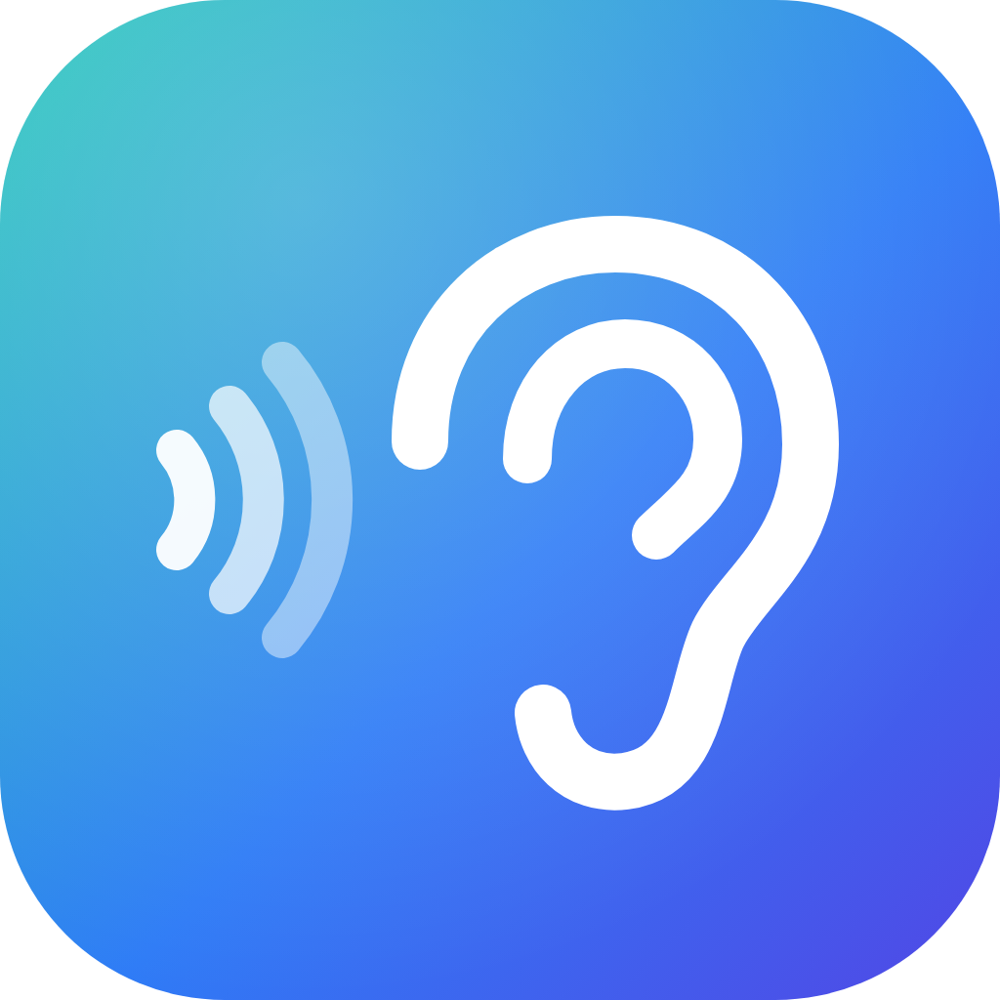
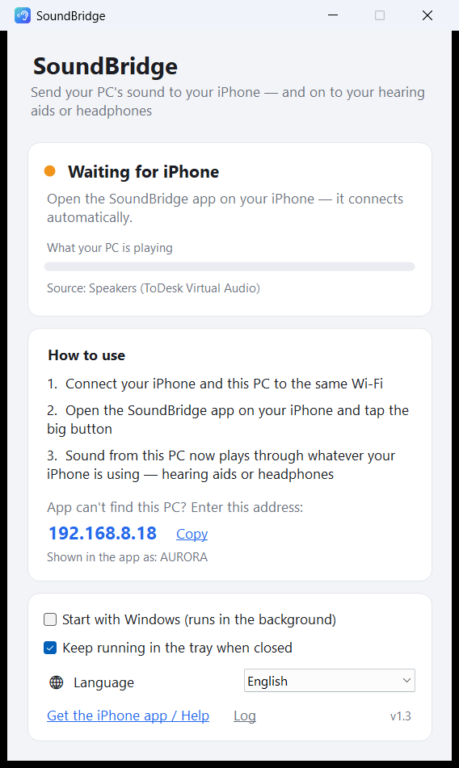

<p align="center">
  
</p>

<h1 align="center">SoundBridge 声桥</h1>

<p align="center">
  <b>Hear your Windows PC through the hearing aids or headphones connected to your iPhone.</b><br>
  <b>把 Windows 电脑的声音，通过 iPhone 送进你的助听器或耳机。</b>
</p>

<p align="center">
  <a href="../../releases/latest">⬇️ Download / 下载</a> ·
  <a href="#english">English</a> ·
  <a href="#中文">中文</a> ·
  <a href="#sponsor--赞助">☕ Sponsor / 赞助</a>
</p>

<p align="center">
  
</p>

---

## English

### Why

Many hearing aids (and cochlear implant processors) can only stream from a phone. Windows can't connect to them, so you can't hear your PC — music, videos, online classes, calls.

SoundBridge fixes that:

```
Windows PC  ──Wi-Fi / LAN──▶  iPhone  ──Bluetooth──▶  hearing aids / AirPods / headphones
```

It also helps if your desktop PC has no Bluetooth, or if you want to keep listening while you walk around the house.

### Features

- **Open and it works.** The PC app starts streaming right away. The iPhone app finds your PC by itself.
- **Low latency.** About 60–150 ms on a normal home network. It adjusts the buffer automatically when your Wi-Fi gets shaky.
- **Made for hearing aids.** It sends audio at the sample rate your output actually uses (16 kHz for most hearing aids), so it uses less Wi-Fi and stutters less.
- **Works with the screen locked.** It keeps playing in the background. You can pause and resume from the lock screen or Dynamic Island.
- **Recovers by itself.** If the stream stalls or the network drops, it reconnects automatically.
- **10 languages.** English, 简体中文, 繁體中文, 日本語, 한국어, Español, Français, Deutsch, Português, Русский. It follows your system language, and you can change it in the app.
- **Private.** Audio goes only over your local network. No accounts, no servers, no data collected.

### Download

Get the files from [**Releases**](../../releases/latest):

| File | For |
|---|---|
| `SoundBridge-Windows-x64.exe` | Most Windows 10/11 PCs. Nothing else needs to be installed. |
| `SoundBridge-Windows-ARM64.exe` | Windows on ARM (e.g. Snapdragon laptops) |
| `SoundBridge-Windows-x64-lite.exe` | Small download, but needs the [.NET 10 Desktop Runtime](https://dotnet.microsoft.com/download/dotnet/10.0) |
| `SoundBridge-iOS-unsigned.ipa` | iPhone / iPad, iOS 15 or later (you need to sideload it, see below) |

### Install

**Windows**
1. Download and run `SoundBridge-Windows-x64.exe`.
2. If Windows SmartScreen warns about an unknown publisher, click **More info → Run anyway**. The app isn't code-signed yet.
3. When Windows Firewall asks, **tick both boxes and click Allow**. Otherwise your iPhone can't connect.

**iPhone**

The app isn't on the App Store yet, so you need to sideload the `.ipa` with any of these:
- [AltStore](https://altstore.io) or [Sideloadly](https://sideloadly.io) with your own free Apple ID. Apps signed this way need to be re-signed every 7 days.
- Any other signing tool or developer certificate you already use.

The first time you open the app, **allow Local Network access**. It needs this to find and receive from your PC.

### Use

1. Put your iPhone and PC on the **same network** (same router; the PC can be on a cable).
2. Open SoundBridge on the PC and leave it running. It can sit in the tray.
3. Open SoundBridge on the iPhone and tap the big button.
4. Anything your PC plays now comes out of your hearing aids or headphones.

### Troubleshooting

- **The iPhone can't find the PC.** Some routers and mobile hotspots block the multicast traffic used for automatic discovery. If nothing is found after 3 seconds, the app scans your local network instead. You can also tap **Enter address** and type the IP shown in the PC window.
- **Sound stutters.** Set **Delay** to *Medium* or *High*, or move closer to the router. 5 GHz Wi-Fi works best.
- **No sound but connected.** Make sure the PC is playing through its **default** output device. SoundBridge captures whatever the default device plays.
- **Lip-sync is a bit off in videos.** Bluetooth hearing aids and headphones add their own delay of about 100–200 ms. That's normal.
- Open **Details** in the iPhone app (or **Log** in the PC app). It shows what's happening if you need to report a problem.

### Build from source

- **PC:** `pc/`, .NET 10 WinForms + [NAudio](https://github.com/naudio/NAudio). Build with `dotnet build pc -c Release`.
- **iPhone:** `ios/`, SwiftUI. The project is generated with [XcodeGen](https://github.com/yonaskolb/XcodeGen) (`cd ios && xcodegen generate`). GitHub Actions builds an unsigned IPA on every push, so you don't need a Mac.
- **Translations:** `i18n/strings.json`. Both apps share this file. Pull requests for new languages or better wording are welcome!

<details>
<summary>Protocol</summary>

TCP port `47800`; discovery via Bonjour `_hearrelay._tcp`, with a /24 subnet scan as a fallback.

1. Phone → PC: `"HRQ1"` + `u32` wanted sample rate + `u16` channels (2), then optionally `"HRN1"` + `u8` length + UTF-8 device name.
2. PC → phone: `"HRLY"` + `u32` sample rate + `u16` channels + `u16` bits (16), followed by continuous 16-bit little-endian interleaved stereo PCM.
3. When the PC is silent, it keeps sending silence, so the phone treats 2.5 s without data as a dead connection and reconnects.
</details>

---

## 中文

### 为什么做这个

很多助听器（还有人工耳蜗处理器）只能连手机，Windows 电脑连不上。所以电脑上的音乐、视频、网课、会议，助听器用户都听不到。

声桥就是解决这个问题的：

```
Windows 电脑  ──Wi-Fi / 网线──▶  iPhone  ──蓝牙──▶  助听器 / AirPods / 耳机
```

台式机没有蓝牙、或者想离开电脑走远一点继续听，也能用。

### 功能

- **打开就能用**：电脑端打开就开始传，iPhone 端自动找到电脑。
- **延迟低**：普通家庭网络下约 60～150 毫秒，网络不稳时会自动多缓冲一点。
- **为助听器优化**：按输出设备实际用的采样率传，助听器一般是 16 kHz，更省网络、更不容易卡。
- **锁屏也能听**：在后台一直播放，锁屏和灵动岛上可以暂停和继续。
- **自动恢复**：断流、断网后会自己重连。
- **10 种语言**：English、简体中文、繁體中文、日本語、한국어、Español、Français、Deutsch、Português、Русский。默认跟随系统语言，也能在 App 里切换。
- **隐私**：声音只在你的局域网里传，不用注册、不经过任何服务器、不收集任何数据。

### 下载

到 [**Releases（发布页）**](../../releases/latest) 下载：

| 文件 | 适用于 |
|---|---|
| `SoundBridge-Windows-x64.exe` | 绝大多数 Windows 10/11 电脑，不用额外装任何东西 |
| `SoundBridge-Windows-ARM64.exe` | ARM 芯片的 Windows 电脑（比如骁龙笔记本） |
| `SoundBridge-Windows-x64-lite.exe` | 体积小，但需要先装 [.NET 10 桌面运行时](https://dotnet.microsoft.com/download/dotnet/10.0) |
| `SoundBridge-iOS-unsigned.ipa` | iPhone / iPad，iOS 15 及以上（需要自己签名安装，见下文） |

### 安装

**Windows**
1. 下载并运行 `SoundBridge-Windows-x64.exe`。
2. 如果 Windows 提示「未知发布者」，点 **更多信息 → 仍要运行**。程序暂时还没有数字签名。
3. 防火墙弹窗时，**两个勾都打上，然后点「允许」**，不然手机连不上电脑。

**iPhone**

暂时还没上架 App Store，需要自己签名安装 `.ipa`，任选一种：
- 用 [AltStore](https://altstore.io) 或 [Sideloadly](https://sideloadly.io)，配合你自己的免费 Apple ID。这种方式每 7 天要重签一次。
- 用你已经在用的其他签名工具或开发者证书。

第一次打开 App 时，请**允许访问「本地网络」**，不然找不到电脑。

### 使用

1. 手机和电脑连**同一个网络**，也就是同一个路由器（电脑插网线也行）。
2. 电脑上打开「声桥」，开着就行，可以缩到右下角托盘。
3. iPhone 上打开「声桥」，点中间的大按钮。
4. 电脑上放的声音，就会从你的助听器或耳机里出来。

### 常见问题

- **手机找不到电脑**：有些路由器、随身 Wi-Fi 会拦截自动发现用的组播包。App 在 3 秒内没发现电脑时，会自动扫描局域网；也可以点「手动输入地址」，填电脑窗口上显示的 IP。
- **声音断断续续**：把「延迟」调到「中」或「高」，或者离路由器近一点，5 GHz Wi-Fi 效果最好。
- **连上了但没声音**：确认电脑是从**默认播放设备**出声的，声桥抓取的是默认播放设备的声音。
- **看视频口型有点对不上**：蓝牙助听器和耳机本身就有 100～200 毫秒延迟，这是正常的。
- 遇到问题，打开 iPhone App 里的「详细信息」或电脑端的「查看日志」，里面会记录发生了什么。

### 自己编译

- **电脑端**：`pc/`，.NET 10 WinForms + [NAudio](https://github.com/naudio/NAudio)，用 `dotnet build pc -c Release` 编译。
- **iPhone 端**：`ios/`，SwiftUI，用 [XcodeGen](https://github.com/yonaskolb/XcodeGen) 生成工程。每次推送 GitHub Actions 都会自动编出未签名 IPA，所以不需要 Mac。
- **翻译**：`i18n/strings.json`，两端共用这一个文件。欢迎提交新语言或改进翻译！

---

## Sponsor / 赞助

SoundBridge is free and open source. If it helps you or someone you care about, you can buy me a coffee ☕

声桥免费开源。如果它帮到了你或你在乎的人，欢迎请我喝杯咖啡 ☕

<p align="center">
  
  <br><sub>WeChat 微信赞赏码</sub>
</p>

## License

[MIT](LICENSE)
